# ReflectSort — STM32 Firmware Architecture & Design Specification

**Project:** ReflectSort — Sensor-Based Seed/Grain Shade Classification and Sorting Prototype  
**Course:** Machine Learning – Embedded Systems Design (ML–ESD)  
**Project Variant:** PROJECT-12-VARIANT-06 | **Team:** ML-ESD-TEAM-117  
**Author:** Ajitesh Karan (2500032236) — Member 4 (Embedded Architecture & Firmware Planning)  
**Firmware Status:** Architectural Design & Pseudocode Specification (Simulation Verification Complete)  

---

## 1. Firmware Design Philosophy & Safety Guarantees

The ReflectSort embedded firmware runs on the **STM32 NUCLEO-F446RE** microcontroller. It is designed as a deterministic, non-blocking state machine with hardware-level safety invariants:

1. **Gated Actuation:** No actuator movement can be triggered without passing through the multi-stage validation gate.
2. **Deterministic Timeouts:** Hardware timers (SysTick / TIM6) enforce strict communication deadlines; missing a host response within the $2000\,\text{ms}$ window immediately drops the system into a safe `HOLD` state.
3. **Independent Watchdog (IWDG):** Guards against firmware deadlock, memory fault, or unbounded loops.
4. **Isolated Memory Buffering:** UART RX/TX buffers use DMA with circular RingBuffers to prevent buffer overflows.

---

## 2. 10-Stage Firmware Execution Pipeline

```
  [1. Power-On Init] ──> [2. Sensor Sample ADC] ──> [3. Digital Filter] ──> [4. Frame & TX Req]
                                                                                   │
  [8. PWM Divert] <── [7. Safety Gate] <── [6. Message Validate] <── [5. RX Response (Timeout)]
         │
  [9. Failsafe Hold (on error)] ──> [10. Diagnostics & Status LED]
```

1. **Peripheral Initialization:** Configure system clocks (180 MHz PLL), GPIO pins, ADC1 with DMA, TIM3 PWM (50 Hz), USART2 (115200 baud), and SysTick timer.
2. **Sensor Data Acquisition:** Trigger multi-channel ADC conversion for Sample LDR (`PA0` / `ADC1_IN0`) and Ambient LDR (`PA1` / `ADC1_IN1`).
3. **Digital Filtering & Baseline Subtraction:** Execute 16× oversampling averaging; compute differential reflectance (`sample_LDR - ambient_LDR`).
4. **Message Framing & Dispatch:** Pack measurements into a JSON-Lines payload with a monotonic `request_id` and send via USART2 TX.
5. **Awaited Host Response:** Listen on USART2 RX with a hardware timer countdown ($2000\,\text{ms}$ maximum window).
6. **Integrity & Protocol Validation:** Check JSON format, verify `request_id == pending_request_id`, and check timestamp freshness.
7. **Whitelisted Action Selection:** Verify label $\in \{\text{BIN\_A}, \text{BIN\_B}, \text{BIN\_C}, \text{REJECT\_UNKNOWN}, \text{HOLD}\}$.
8. **Actuator Limit Enforcement:** Translate validated label to safe PWM pulse width ($1.00\,\text{ms} \le t_{\text{pulse}} \le 1.95\,\text{ms}$).
9. **Failsafe Transition:** On any checksum error, timeout, corrupt packet, or invalid label, immediately abort movement and command neutral `HOLD` ($1.50\,\text{ms}$).
10. **Diagnostics & Status Telemetry:** Update on-board status LEDs (Green: OK / Red: Fault) and record cycle telemetry.

---

## 3. Firmware State Machine (Mermaid Diagram)

```mermaid
stateDiagram-v2
    [*] --> STATE_INIT : Power On / Reset

    state STATE_INIT {
        [*] --> ConfigClocks
        ConfigClocks --> ConfigADC_DMA
        ConfigADC_DMA --> ConfigPWM_Timer
        ConfigPWM_Timer --> ConfigUSART2
        ConfigUSART2 --> CalibrateSensors
    }

    STATE_INIT --> STATE_IDLE_READY : Init Succeeded
    STATE_INIT --> STATE_HARDWARE_FAULT : Peripheral Error

    state STATE_IDLE_READY {
        [*] --> StandbyHomePosition
        StandbyHomePosition --> AwaitTrigger : Specimen Detected
    }

    STATE_IDLE_READY --> STATE_ACQUISITION : Start Sampling

    state STATE_ACQUISITION {
        [*] --> EnableLED
        EnableLED --> SampleADC_16x
        SampleADC_16x --> CalculateFeatures
        CalculateFeatures --> DisableLED
    }

    STATE_ACQUISITION --> STATE_TX_REQUEST : Features Ready

    state STATE_TX_REQUEST {
        [*] --> FrameJSON_Payload
        FrameJSON_Payload --> SendUART_DMA
        SendUART_DMA --> StartTimeoutTimer_2000ms
    }

    STATE_TX_REQUEST --> STATE_AWAIT_RESPONSE : Dispatched

    state STATE_AWAIT_RESPONSE {
        [*] --> ListenUART_RX
        ListenUART_RX --> DecisionReceived : Character Delimiter ('\n')
        ListenUART_RX --> TimeoutExpired : Timer >= 2000ms
    }

    STATE_AWAIT_RESPONSE --> STATE_VALIDATION_GATE : Packet Arrived
    STATE_AWAIT_RESPONSE --> STATE_SAFE_HOLD : Timeout Expired

    state STATE_VALIDATION_GATE {
        [*] --> CheckSchemaIntegrity
        CheckSchemaIntegrity --> CheckRequestIDMatch : JSON Valid
        CheckRequestIDMatch --> CheckTimestampFreshness : ID Matches
        CheckTimestampFreshness --> CheckLabelWhitelist : Fresh
        CheckLabelWhitelist --> ValidationPassed : Label in Whitelist
    }

    STATE_VALIDATION_GATE --> STATE_ACTUATE_DIVERTER : Validation Passed
    STATE_VALIDATION_GATE --> STATE_SAFE_HOLD : Validation Failed (Corrupt/Mismatched/Stale)

    state STATE_ACTUATE_DIVERTER {
        [*] --> ResolvePWM_PulseWidth
        ResolvePWM_PulseWidth --> ClampSafetyEnvelope
        ClampSafetyEnvelope --> DriveTIM3_PWM
        DriveTIM3_PWM --> SettleActuator_120ms
    }

    STATE_ACTUATE_DIVERTER --> STATE_IDLE_READY : Cycle Complete

    state STATE_SAFE_HOLD {
        [*] --> DriveNeutral_90deg
        DriveNeutral_90deg --> FlashFaultLED
        FlashFaultLED --> LogErrorTelemetry
    }

    STATE_SAFE_HOLD --> STATE_IDLE_READY : Error Cleared / Next Sample
    STATE_HARDWARE_FAULT --> [*] : Requires Power Cycle
```



---

## 4. STM32 Peripheral Configuration Specifications

### 4.1 ADC1 Peripheral Configuration
- **Mode:** Multi-channel Scan Mode, Continuous Conversion disabled (software triggered).
- **Channels:** Channel 0 (`PA0` / `ADC1_IN0` - Sample LDR), Channel 1 (`PA1` / `ADC1_IN1` - Ambient LDR).
- **Resolution:** 12-bit ($0 \dots 4095$ digital counts corresponding to $0.0\,\text{V} \dots 3.30\,\text{V}$).
- **Sampling Time:** `ADC_SAMPLETIME_480CYCLES` (guarantees adequate impedance matching for high-resistance photoresistor dividers).
- **DMA Configuration:** DMA2 Stream 0, Channel 0, Circular/Normal buffer mode into `uint16_t adc_raw_buffer[2]`.

### 4.2 Timer 3 (TIM3) PWM Configuration for Servo
- **Clock Source:** APB1 Timer Clock = $90\,\text{MHz}$.
- **Prescaler (PSC):** $1800 - 1 \implies \text{Timer Clock} = 50\,\text{kHz}$ ($20\,\mu\text{s}$ per tick).
- **Auto-Reload Register (ARR):** $1000 - 1 \implies \text{PWM Period} = 20.0\,\text{ms}$ ($50\,\text{Hz}$).
- **Capture/Compare Channel 1 (`PA6` / AF2) or Channel 2 (`PC7` / AF2):**
  - Neutral / Hold ($1.50\,\text{ms}$): `CCR1 = 75`
  - Bin A ($1.25\,\text{ms}$ / $45^\circ$): `CCR1 = 62`
  - Bin B ($1.50\,\text{ms}$ / $90^\circ$): `CCR1 = 75`
  - Bin C ($1.75\,\text{ms}$ / $135^\circ$): `CCR1 = 87`
  - Reject ($1.92\,\text{ms}$ / $165^\circ$): `CCR1 = 96`

### 4.3 USART2 Configuration
- **Baud Rate:** $115200\,\text{bps}$, Word Length: 8 bits, Parity: None, Stop Bits: 1 (8N1).
- **Pins:** `PA2` (TX, AF7) and `PA3` (RX, AF7) routed to ST-LINK Virtual COM Port.
- **Interrupts:** USART2 Global Interrupt enabled on Idle Line detection (`USART_IT_IDLE`) for variable-length JSON packet reception.

---

## 5. Firmware C-Code Skeleton (STM32CubeIDE HAL Template)

```c
/**
  ******************************************************************************
  * @file           : main.c
  * @brief          : ReflectSort STM32 NUCLEO-F446RE Main Control Firmware
  * @author         : Ajitesh Karan (2500032236) - ML-ESD-TEAM-117
  ******************************************************************************
  */

#include "main.h"
#include "stdio.h"
#include "string.h"
#include "stdbool.h"

/* Peripheral Handles */
ADC_HandleTypeDef hadc1;
DMA_HandleTypeDef hdma_adc1;
TIM_HandleTypeDef htim3;
UART_HandleTypeDef huart2;

/* Communication & State Buffers */
#define RX_BUFFER_SIZE 512
#define TX_BUFFER_SIZE 512
#define MAX_TIMEOUT_MS 2000

uint8_t rx_buffer[RX_BUFFER_SIZE];
uint8_t tx_buffer[TX_BUFFER_SIZE];
uint16_t adc_raw[2]; // [0] = Sample LDR (PA0), [1] = Ambient LDR (PA1)
uint32_t current_request_id = 0;

typedef enum {
    DECISION_BIN_A,
    DECISION_BIN_B,
    DECISION_BIN_C,
    DECISION_REJECT_UNKNOWN,
    DECISION_HOLD
} SortingDecision_t;

/* Actuator Angles mapped to TIM3 CCR1 register values (20us per tick) */
#define PWM_CCR_BIN_A    62  // 1.25 ms (45 deg)
#define PWM_CCR_BIN_B    75  // 1.50 ms (90 deg)
#define PWM_CCR_BIN_C    87  // 1.75 ms (135 deg)
#define PWM_CCR_REJECT   96  // 1.92 ms (165 deg)
#define PWM_CCR_HOLD     75  // Neutral Home (90 deg)

void Actuate_Diverter(SortingDecision_t decision) {
    uint32_t target_ccr = PWM_CCR_HOLD;
    switch(decision) {
        case DECISION_BIN_A:          target_ccr = PWM_CCR_BIN_A; break;
        case DECISION_BIN_B:          target_ccr = PWM_CCR_BIN_B; break;
        case DECISION_BIN_C:          target_ccr = PWM_CCR_BIN_C; break;
        case DECISION_REJECT_UNKNOWN: target_ccr = PWM_CCR_REJECT; break;
        case DECISION_HOLD:
        default:                      target_ccr = PWM_CCR_HOLD; break;
    }
    __HAL_TIM_SET_COMPARE(&htim3, TIM_CHANNEL_1, target_ccr);
    HAL_Delay(120); // Settling delay
}

void Sample_Sensors(float *sample_ldr, float *ambient_ldr) {
    uint32_t acc_sample = 0, acc_ambient = 0;
    HAL_GPIO_WritePin(GPIOB, GPIO_PIN_0, GPIO_PIN_SET); // LED ON (PB0)
    HAL_Delay(5); // Optical settling

    for (int i = 0; i < 16; i++) {
        HAL_ADC_Start(&hadc1);
        HAL_ADC_PollForConversion(&hadc1, 10);
        acc_sample += HAL_ADC_GetValue(&hadc1);
        HAL_ADC_PollForConversion(&hadc1, 10);
        acc_ambient += HAL_ADC_GetValue(&hadc1);
    }
    HAL_GPIO_WritePin(GPIOB, GPIO_PIN_0, GPIO_PIN_RESET); // LED OFF (PB0)

    *sample_ldr = (float)acc_sample / 16.0f;
    *ambient_ldr = (float)acc_ambient / 16.0f;
}

int main(void) {
    HAL_Init();
    SystemClock_Config();
    MX_GPIO_Init();
    MX_DMA_Init();
    MX_ADC1_Init();
    MX_TIM3_Init();
    MX_USART2_UART_Init();

    HAL_TIM_PWM_Start(&htim3, TIM_CHANNEL_1);
    Actuate_Diverter(DECISION_HOLD); // Initial neutral position

    while (1) {
        if (HAL_GPIO_ReadPin(GPIOC, GPIO_PIN_13) == GPIO_PIN_RESET) { // User Button PC13
            float s_ldr = 0.0f, a_ldr = 0.0f;
            current_request_id++;

            Sample_Sensors(&s_ldr, &a_ldr);
            float diff = s_ldr - a_ldr;

            // Frame JSON-Lines Request
            int len = snprintf((char*)tx_buffer, TX_BUFFER_SIZE,
                "{\"type\":\"measurement\",\"request_id\":\"REQ-%lu\",\"data_source\":\"physical\",\"features\":{\"sample_LDR\":%.2f,\"ambient_LDR\":%.2f,\"differential_LDR\":%.2f}}\n",
                current_request_id, s_ldr, a_ldr, diff);

            HAL_UART_Transmit(&huart2, tx_buffer, len, 100);

            // Await Response with 2000ms Hardware Timeout
            memset(rx_buffer, 0, RX_BUFFER_SIZE);
            HAL_StatusTypeDef rx_status = HAL_UART_Receive(&huart2, rx_buffer, RX_BUFFER_SIZE, MAX_TIMEOUT_MS);

            if (rx_status == HAL_OK) {
                // Parse & Validate Decision
                if (strstr((char*)rx_buffer, "\"BIN_A\"") != NULL) {
                    Actuate_Diverter(DECISION_BIN_A);
                } else if (strstr((char*)rx_buffer, "\"BIN_B\"") != NULL) {
                    Actuate_Diverter(DECISION_BIN_B);
                } else if (strstr((char*)rx_buffer, "\"BIN_C\"") != NULL) {
                    Actuate_Diverter(DECISION_BIN_C);
                } else if (strstr((char*)rx_buffer, "\"REJECT_UNKNOWN\"") != NULL) {
                    Actuate_Diverter(DECISION_REJECT_UNKNOWN);
                } else {
                    Actuate_Diverter(DECISION_HOLD); // Unrecognized label -> Safe Hold
                }
            } else {
                Actuate_Diverter(DECISION_HOLD); // Timeout or UART error -> Safe Hold
            }

            HAL_Delay(500); // Debounce / Cycle delay
        }
    }
}
```
